<p align="center">
  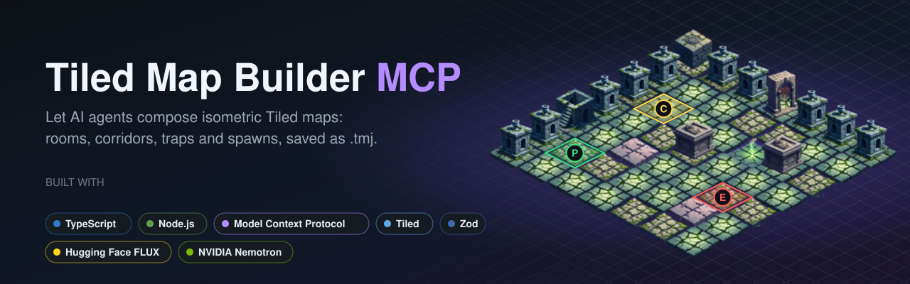
</p>

<p align="center">
  <a href="https://nodejs.org"></a>
  <a href="https://www.typescriptlang.org"></a>
  <a href="https://modelcontextprotocol.io"></a>
  <a href="https://www.mapeditor.org"></a>
  <a href="https://zod.dev"></a>
  <a href="docs/sprite-generation.md"></a>
  <a href="docs/nemotron.md"></a>
  <a href="LICENSE"></a>
</p>

<p align="center">
  <b>An MCP server that lets AI agents build isometric <a href="https://www.mapeditor.org">Tiled</a> maps</b><br>
  rooms, corridors, doors, traps, chests and spawns, validated and saved as <code>.tmj</code> files you open in Tiled.
</p>

<p align="center">
  <a href="#-quick-start">Quick start</a> ·
  <a href="docs/client-setup.md">Connect a client</a> ·
  <a href="docs/tools.md">Tool reference</a> ·
  <a href="docs/map-format.md">Map format</a> ·
  <a href="docs/themes.md">Themes</a> ·
  <a href="docs/troubleshooting.md">Troubleshooting</a>
</p>

---

## ✨ Features

- 🗺️ **30 MCP tools** to create maps, paint tiles, generate rooms and corridors, and place doors, chests, traps, levers, stairs and spawns.
- 🏰 **3 layout presets**: a crypt, a castle floor and a werewolf den, each built in one call.
- 🎨 **20 themes**, 12 of them with bundled isometric sprites ready to use.
- 🛡️ **Guard rails for agents**: placing a chest on a wall, outside a room or on another object fails with a message that says how to fix it, and `validate_map` checks the map before export.
- 📐 **Correct Tiled output**: object positions follow Tiled's isometric convention, and saved files point at their sprites with relative paths, so they open directly in Tiled.
- 🧠 **Agent skill and MCP prompt** (`map_builder`): a step-by-step workflow with an ASCII sketch confirmation, theme heuristics and tactical rules.
- 🖌️ **Optional sprite generation** with FLUX.1-dev through Hugging Face. It is paid, opt-in, and never runs by accident.
- 🔌 Works with **any MCP client**: Claude Code, Claude Desktop, Cursor, VS Code, Zed, OpenCode, and agents running NVIDIA Nemotron.

## 🖼️ Preview

<p align="center">
  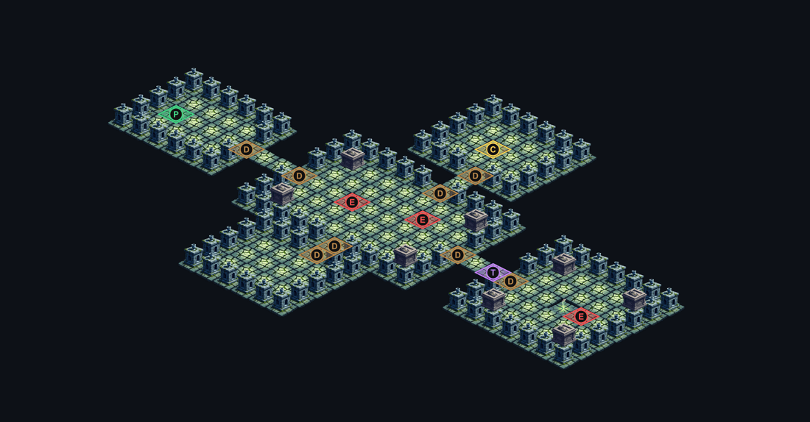
  <br><sub>A 28x18 crypt from <code>generate_crypt_layout</code> plus a few <code>place_*</code> calls.
  Markers: <b>P</b> player, <b>E</b> enemy, <b>D</b> door, <b>C</b> chest, <b>T</b> trap. Rendered with <code>npm run preview</code>.</sub>
</p>

<p align="center">
  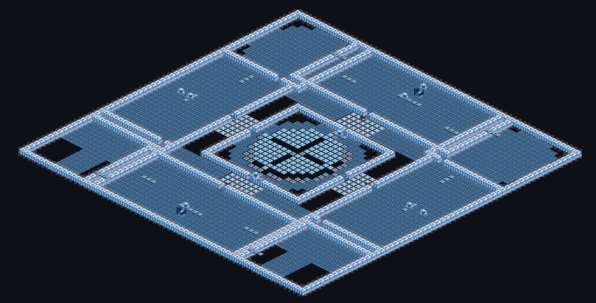
  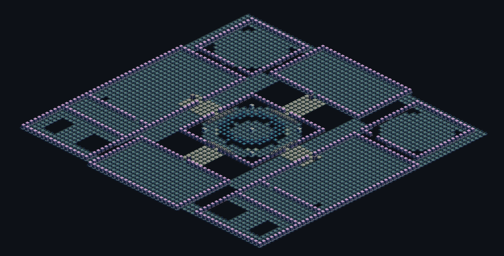
  <br><sub>Sample maps in <a href="maps/"><code>maps/</code></a>: an ice fortress and a flooded cavern, both 64x64.</sub>
</p>

## 🧱 Tech stack

| | Technology | Role in this project |
|---|---|---|
|  | [Model Context Protocol](https://modelcontextprotocol.io) | How agents discover and call the map tools (stdio transport) |
|  | [TypeScript](https://www.typescriptlang.org) | Server source in `tiled-mcp/src` |
|  | [Node.js](https://nodejs.org) 20.9+ | Runtime for the server and the scripts |
|  | [Zod](https://zod.dev) | Validates every tool input and generates the JSON schemas agents see |
| 🗺️ | [Tiled](https://www.mapeditor.org) | Map editor that opens the generated `.tmj` files |
|  | [Hugging Face Inference](https://huggingface.co/docs/inference-providers) + FLUX.1-dev | Optional, paid tile sprite generation |
| 🖼️ | [sharp](https://sharp.pixelplumbing.com) | Background removal and resizing of generated sprites, PNG previews |
|  | [NVIDIA Nemotron](https://build.nvidia.com) | One of the agent models this server was designed and tested with |

## 🚀 Quick start

**Requirements**: [Node.js](https://nodejs.org) 20.9 or newer and git. [Tiled](https://www.mapeditor.org) is optional, to view and edit the maps.

```bash
git clone https://github.com/4math2379/Tiled-MCP-Server.git
cd Tiled-MCP-Server
npm install        # installs the server workspace
npm run build      # compiles tiled-mcp/src to tiled-mcp/dist
npm run smoke      # optional: 39 offline end-to-end checks
```

Then register the server with your MCP client. With **Claude Code**, from the repository folder:

```bash
claude mcp add tiled-map-builder -- node "$(pwd)/tiled-mcp/dist/index.js"
```

Most other clients take the same JSON block (replace the path with your absolute path):

```json
{
  "mcpServers": {
    "tiled-map-builder": {
      "command": "node",
      "args": ["/absolute/path/to/Tiled-MCP-Server/tiled-mcp/dist/index.js"]
    }
  }
}
```

👉 Per-client instructions for Claude Desktop, Cursor, VS Code, Zed, OpenCode, Windsurf and the MCP Inspector are in **[docs/client-setup.md](docs/client-setup.md)**.

Now ask your agent:

> Build a 28x18 crypt under an abandoned chapel with two skeletons in the nave, a locked chest in the north chamber and a dart trap before the deep crypt. Save it as crypt-chapel.tmj.

The map lands in `maps/crypt-chapel.tmj`. Open it in Tiled, or render a preview without Tiled:

```bash
npm run preview -- maps/crypt-chapel.tmj
```

## 🧭 How it works

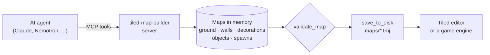

1. `create_map` makes an empty map in a **theme** and returns a `mapId`.
2. Tiles are painted by **role** (`walkable_floor`, `wall`, `hazard_primary`, `obstacle_decor`, ...) and the theme picks the sprite.
3. Each map has three tile layers, **ground**, **walls** and **decorations**, and two object layers, **objects** (doors, chests, traps, levers, stairs) and **spawns** (player, enemy, NPC).
4. Coordinates are grid cells: `x` is the column and `y` the row; (0,0) is the top corner of an isometric map.
5. Maps live in server memory until you call `save_to_disk` or `export_json`.

Details, properties and importer formulas: **[docs/map-format.md](docs/map-format.md)**.

## 🧰 Tools

| Group | Tools |
|---|---|
| Map lifecycle | `list_themes` · `create_map` · `list_maps` · `describe_map` · `discard_map` |
| Painting | `paint_tile` · `paint_rect` · `paint_wall_border` · `erase_tile` · `get_tile_info` |
| Rooms and corridors | `generate_room` · `generate_corridor` |
| Layout presets | `generate_crypt_layout` (27x18+) · `generate_castle_floor` (27x20+) · `generate_werewolf_den` (22x16+) |
| Objects | `place_door` · `place_chest` · `place_stairs_object` · `place_trap` · `place_lever` |
| Spawns | `place_spawn_player` · `place_spawn_enemy` · `place_spawn_npc` |
| Validation and export | `validate_map` · `export_json` · `save_to_disk` |
| Sprites | `preview_sprite_prompt` (free) · `generate_tile_sprite` 💸 · `generate_theme_sprite_set` 💸 · `override_tile_image` |

Full parameters, generated from the server itself: **[docs/tools.md](docs/tools.md)**.

## 🎨 Themes

| Theme key | Display name | Setting | Sprites |
|---|---|---|---|
| `CRYPT` | Crypte mournevaldienne | Burial vaults, cracked flagstones, poison vents | ✅ |
| `CASTLE` | Castel Von Drak | Black marble halls, throne room, grand stairs | ✅ |
| `WEREWOLF_DEN` | Tanière de loups-garous | Damp caves, bones, blood pools | ✅ |
| `TAVERN_BLOOD_PRINCE` | Auberge du Prince Sanglant | Tavern interior, oak tables, hearth | ✅ |
| `VILLAGE` | Village mournevaldien | Wet cobblestones, half-timbered houses, well | ✅ |
| `HAUNTED_FOREST` | Forêt de Drakenmark | Dark undergrowth, brambles, parasitic mist | ✅ |
| `MAUSOLEUM` | Mausolée | Veined marble, fallen-angel statues, urns | ✅ |
| `BLOOD_TOMB` | Tombeau de sang | Ritual sanctuary, bleeding runes, altar | ✅ |
| `AQUATIC` | Eaux Croupies | Stagnant water, water lilies, sunken ruins | ✅ |
| `GLACIAIRE` | Toundra Glacée | Black ice, frozen statues, thin ice | ✅ |
| `INONDE` | Cote Inondee | Drowned city, kelp, deep currents | ✅ |
| `ELECTRONIQUE` | Reseau Electronique | Circuit boards, cables, mainframe cores | ✅ |
| `VOLCAN` | Pente Volcanique | Lava flows, obsidian, ash | ➖ |
| `FORET` | Foret Sombre | Twisted woods, quicksand, standing stones | ➖ |
| `HIVER` | Plaine Enneigee | Snowfields, frozen lakes, cairns | ➖ |
| `PRINTEMPS` | Prairie Printaniere | Flowering meadows, streams, maypole | ➖ |
| `ETE` | Plaine Estivale | Golden wheat, cracked earth, scarecrows | ➖ |
| `AUTOMNE` | Foret d'Automne | Russet leaves, bog mire, mushrooms | ➖ |
| `DESOLATION` | Terre Desolee | Ash pits, charred trees, ruins | ➖ |
| `FUTURISTE` | Cite Futuriste | Chrome, neon, plasma leaks, server racks | ➖ |

✅ sprites bundled in `assets/` · ➖ no sprites yet: the maps are valid and Tiled shows placeholders until you [generate the sprites](docs/sprite-generation.md).

<p align="center">
  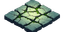
  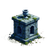
  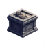
  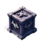
  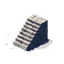
  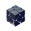
  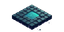
  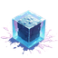
  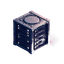
  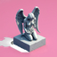
</p>

More about each theme's roles and hazards: **[docs/themes.md](docs/themes.md)**.

## 🤖 Agent skill and prompt

[`skills/map-builder/SKILL.md`](skills/map-builder/SKILL.md) teaches an agent the whole workflow: infer the theme, sketch the layout in ASCII and ask for confirmation, build, validate, save.

- **Claude Code**: copy the folder to `~/.claude/skills/map-builder/` (all projects) or `.claude/skills/map-builder/` (one project), then type `/map-builder crypt 28x18 ...`.
- **Any MCP client**: the server exposes the same workflow as the prompt **`map_builder`**, which takes a free-form `description`.

## ⚙️ Configuration

Nothing is required for map building. Optional settings go in `tiled-mcp/.env` (copy [`tiled-mcp/.env.example`](tiled-mcp/.env.example)) or in the `env` block of your MCP client:

| Variable | Default | Purpose |
|---|---|---|
| `TILED_MAPS_DIR` | `maps/` | Where `save_to_disk` writes relative paths |
| `TILED_ASSETS_DIR` | `assets/` | Sprite folder (`<theme>/<role>.png`) |
| `TILED_OBJECT_COORDS` | `tiled` | `screen` restores the legacy object encoding for older importers |
| `HUGGINGFACE_API_KEY` or `HF_TOKEN` | none | Only for paid sprite generation |

All variables, the `.env` lookup order and security notes: **[docs/configuration.md](docs/configuration.md)**.

## 💸 Sprite generation (optional, paid)

Map building is free and offline. Generating new sprites calls FLUX.1-dev through Hugging Face Inference Providers and **costs money per sprite**. The tools never overwrite an existing sprite unless you pass `force`, and the batch script asks for `--yes`:

```bash
node scripts/gen-theme-set.mjs VOLCAN --dry-run   # free: shows what would be generated
node scripts/gen-theme-set.mjs VOLCAN --yes       # paid: about 10 sprites
```

Read **[docs/sprite-generation.md](docs/sprite-generation.md)** before you start.

## 🟩 Using it with NVIDIA Nemotron

The server works with any model that supports tool calling. It was built alongside agents running **Nemotron 3.5 Super-VL** on the NVIDIA API free tier, for example through OpenCode. The NVIDIA key belongs to your agent, not to this server. Setup: **[docs/nemotron.md](docs/nemotron.md)**.

## 🗂️ Repository layout

```
tiled-mcp/          MCP server (TypeScript): src/, package.json, tsconfig.json, .env.example
  src/tools/        tool groups: lifecycle, paint, procedural, layout-presets, objects, export, generation
  src/themes/       20 theme definitions and the FLUX prompt catalog
skills/map-builder/ agent skill, also served as the map_builder MCP prompt
maps/               sample .tmj maps (default output folder of save_to_disk)
assets/             isometric sprites per theme: <theme>/<role>.png
scripts/            example map scripts, preview renderer, sprite batch, docs generator, smoke test
docs/               documentation, banner and preview images
```

## 🛠️ Scripts

| Command | What it does |
|---|---|
| `npm run build` | Compile the server |
| `npm run smoke` | Start the server and run 39 offline end-to-end checks |
| `npm run inspect` | Open the server in the [MCP Inspector](https://github.com/modelcontextprotocol/inspector) |
| `npm run preview -- <map.tmj>` | Render a map to PNG without Tiled |
| `npm run examples` | Rebuild the three scripted sample maps in `maps/` |
| `npm run docs` | Regenerate `docs/tools.md` and `docs/themes.md` from the server |
| `node scripts/gen-theme-set.mjs <THEME> --yes` | Generate a theme's missing sprites (paid) |

## 🤝 Contributing

Issues and pull requests are welcome. See **[CONTRIBUTING.md](CONTRIBUTING.md)** for the development loop and **[CHANGELOG.md](CHANGELOG.md)** for what changed.

## 📄 License

[MIT](LICENSE). Tiled is an independent project by Thorbjørn Lindeijer. Some theme names evoke classic gothic-horror settings; this project is not affiliated with or endorsed by their rights holders.
