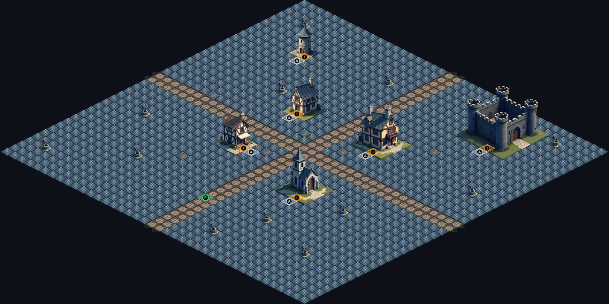

# Worlds and buildings

Large outdoor maps with buildings the player can walk into. `place_building` puts a house,
shop, tavern, temple, tower or castle on an outdoor map and creates its interior as a separate
map; walking onto the entrance loads the interior, and its exit brings the player back outside.
`link_maps` joins any other pair of maps the same way, for example the floors of a castle.

```
 outdoor map (village.tmj)                    interior map (miller-house-interior.tmj)
 +-----------------------------+              +-------------------------+
 |        ____                 |  targetMap   |  # # # # # # # # # # #  |
 |       /    \  house         | -----------> |  # . . . . . . . . . #  |
 |      |______|               |  targetSpawn |  # . . . . . . . . . #  |
 |          I  <- entrance     |              |  # . . . . A . . . . #  |  A = "...-inside"
 |          A  <- "...-outside"| <----------- |  # # # # # O # # # # #  |  O = exit
 +-----------------------------+              +-------------------------+
```



The sample world in [`maps/crossroads-village/`](../maps/crossroads-village/) has six buildings,
their interiors and a cellar under the castle; `node scripts/create-village-world.mjs` rebuilds it.
On the Hugging Face Space, the web page's **Village (enter buildings)** example builds one like it.

## How it works

A **transition** is an object with two properties:

| Property | Type | Meaning |
|---|---|---|
| `targetMap` | file | the `.tmj` file of the other map, relative to this one |
| `targetSpawn` | string | the name of an `arrival` spawn in that map |

When the player steps on a transition, the game loads `targetMap` and puts the player on the
spawn named `targetSpawn`. Every arrival spawn stands next to the transition leading back, not on
it, so arriving never bounces the player straight back. All of it is plain Tiled data: any engine
can follow it, and Tiled opens the target map when you right-click `targetMap`.

`place_building` writes, in one call:

| Where | What |
|---|---|
| outdoor map, `buildings` layer | the building sprite, a tile object over its square footprint |
| outdoor map, `objects` layer | an `entrance` on the door cell of the footprint edge |
| outdoor map, `spawns` layer | an `arrival` spawn `<buildingId>-outside` in front of the door |
| new interior map | a furnished layout, an `exit` in the wall, an `arrival` spawn `<buildingId>-inside` |

The full list of properties is in [map-format.md](map-format.md#buildings-and-transitions).

## Build a world

From any MCP client (Claude Code, Cursor, ...), or with the `map_builder` prompt, which knows
these steps:

```text
create_map(name="Crossroads village", width=96, height=96, theme="VILLAGE")   -> mapId
paint_rect(mapId, layer="ground", x1=0, y1=0, x2=95, y2=95, role="walkable_floor")
paint_rect(mapId, layer="ground", x1=0, y1=47, x2=95, y2=48, role="walkable_floor_alt")  # a road
place_building(mapId, buildingType="house",  x=20, y=40, name="Miller house")
place_building(mapId, buildingType="tavern", x=40, y=42, name="Crossroads tavern")
place_building(mapId, buildingType="castle", x=70, y=20, door="south")
link_maps(fromMapId=<castle interior>, fromX=12, fromY=8,
          toMapId=<a cellar map>, toX=5, toY=4, kind="stairs")                  # optional
place_spawn_player(mapId, x=10, y=48)
validate_world(mapId)          # every link leads somewhere real, every map can be entered
save_world(mapId, folder="crossroads")                                          # all maps, side by side
```

Rules the tools enforce:

- Maps go up to **256x256** cells (128x128 on the hosted server; `TILED_MAX_MAP_SIZE` changes it).
- The footprint must be painted ground with no wall and no object; props on it are cleared.
- The cell in front of the door must be free floor: it holds the outside arrival point.
- `door` is `south` (default, the bottom-left face on screen) or `east` (the bottom-right face).
- One theme per map: an outdoor map is one theme, each interior can use another.

| Type | Footprint | Sprite | Default interior |
|---|---|---|---|
| `house` | 3x3 | 192x192 | 12x10 room, `TAVERN_BLOOD_PRINCE` |
| `shop` | 3x3 | 192x192 | 10x8 room, `TAVERN_BLOOD_PRINCE` |
| `tavern` | 4x4 | 256x256 | 16x12 room, `TAVERN_BLOOD_PRINCE` |
| `temple` | 4x4 | 256x256 | 14x12 room, `MAUSOLEUM` |
| `tower` | 2x2 | 128x192 | 9x9 room, `CASTLE` |
| `castle` | 6x6 | 384x384 | 27x20 castle floor, `CASTLE` |

Override the interior with `interiorTheme`, `interiorWidth` and `interiorHeight`, then reshape it
with the usual tools: its `mapId` is in the result. `interior: false` places a building that
cannot be entered.

`save_world` writes the outdoor map and every map linked to it into one folder, each under the
file name its links use (`describe_map` shows it). On the hosted server it returns one `.zip`.
Use `save_to_disk` only for maps without links.

## Building sprites (FLUX, paid)

The buildings are large images in `assets/buildings/<type>.png`. Until they exist, the map works
and Tiled and the preview show placeholders. Generate them once with FLUX.1-dev, billed to your
Hugging Face account, one call each (see [sprite-generation.md](sprite-generation.md)):

```bash
node scripts/gen-building-sprites.mjs --dry-run   # free: the 6 prompts and sizes
node scripts/gen-building-sprites.mjs --yes       # generates the missing ones
```

or from an agent: `generate_building_sprite(buildingType="castle")`. A variant such as a snowy
house is `generate_building_sprite(buildingType="house", variant="snowy", extraDetail="roof covered in snow")`,
then `place_building(..., spriteVariant="snowy")`.

## Open it in Tiled

Open the outdoor map's `.tmj`. Select an entrance on the `objects` layer: in the Properties
panel, right-click `targetMap` to open the interior. The `buildings` layer holds the sprites;
hide it to see the footprints underneath.

## Load it in Godot 4

Draw the maps with whatever you already use: a Tiled importer add-on from the Godot Asset Library
(for example YATI) or your own `TileMapLayer`. For an isometric `TileMapLayer`, use a `TileSet`
with tile shape **Isometric**, tile layout **Diamond Down** and tile size 64x32, so Godot cells
match Tiled cells.

The transitions only need the `.tmj` JSON. This script follows them:

```gdscript
# world_loader.gd: follows the transitions of maps written by save_world.
extends Node

signal map_changed(file_name: String, map: Dictionary, arrival: Vector2i)

@export_dir var world_dir := "res://maps/crossroads"

var map: Dictionary = {}
var transitions: Dictionary = {}  # Vector2i cell -> {"map": String, "spawn": String}
var spawns: Dictionary = {}       # spawn name -> Vector2i cell
var blocked: Dictionary = {}      # Vector2i cell -> true (building footprints)


func load_map(file_name: String, spawn_name := "") -> void:
	map = JSON.parse_string(FileAccess.get_file_as_string(world_dir.path_join(file_name)))
	transitions.clear()
	spawns.clear()
	blocked.clear()
	var iso: bool = map["orientation"] == "isometric"
	var unit_x: float = map["tileheight"] if iso else map["tilewidth"]
	var unit_y: float = map["tileheight"]
	var start := Vector2i.ZERO
	for layer in map["layers"]:
		if layer["type"] != "objectgroup":
			continue
		for obj in layer["objects"]:
			var props := {}
			for p in obj.get("properties", []):
				props[p["name"]] = p["value"]
			if layer["name"] == "buildings":
				var fx := int(props["footprintX"])
				var fy := int(props["footprintY"])
				var n := int(props["footprintSize"])
				for y in range(fy, fy + n):
					for x in range(fx, fx + n):
						blocked[Vector2i(x, y)] = true
				continue
			var cell := Vector2i(floori(obj["x"] / unit_x), floori(obj["y"] / unit_y))
			if props.get("targetMap", "") != "":
				transitions[cell] = {"map": props["targetMap"], "spawn": props.get("targetSpawn", "")}
				blocked.erase(cell)  # the entrance cell of a footprint stays walkable
			if layer["name"] == "spawns":
				spawns[obj["name"]] = cell
				if props.get("role", "") == "player":
					start = cell
	map_changed.emit(file_name, map, spawns.get(spawn_name, start))


## Call after the player moved onto `cell`.
func on_player_moved(cell: Vector2i) -> void:
	if transitions.has(cell):
		var t: Dictionary = transitions[cell]
		load_map(t["map"], t["spawn"])


## Movement check: building footprints are solid.
func is_blocked(cell: Vector2i) -> bool:
	return blocked.has(cell)
```

Start with `load_map("crossroads-village.tmj")`, the map holding the player spawn
(`validate_world` lists it under `startMaps`). In `map_changed`, swap the displayed map and move
the player to `arrival` (`TileMapLayer.map_to_local(arrival)` gives its position).

`save_world` writes sprite paths relative to the repository's `assets/` folder (for example
`../../assets/village/wall.png` from `maps/crossroads/`). Copy `assets/` and the world folder into
your Godot project with the same relative layout (`res://assets/` and `res://maps/crossroads/`),
or use the `.zip` from the hosted server, which bundles the sprites next to the maps.

## Limits

- On the Hugging Face web page, the AI agent can place buildings (each with its interior) but
  not generate new building sprites or save files: the page packs every linked map into its
  `.zip`. MCP clients get every tool.
- Building footprints are square and the door is on the south or east face.
- The interiors are starting points: one room per building, or a castle floor.
